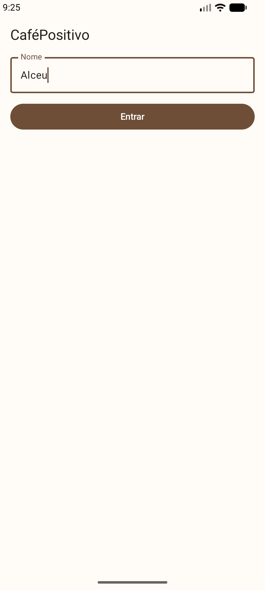
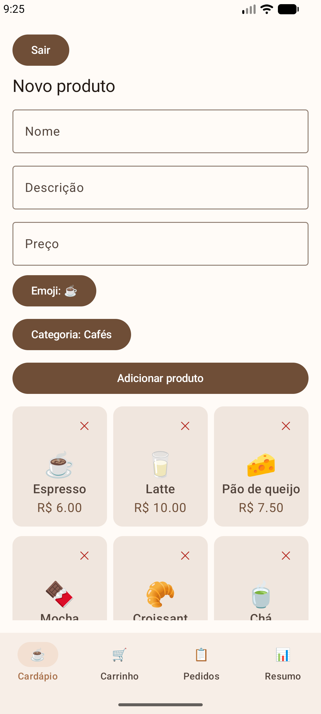
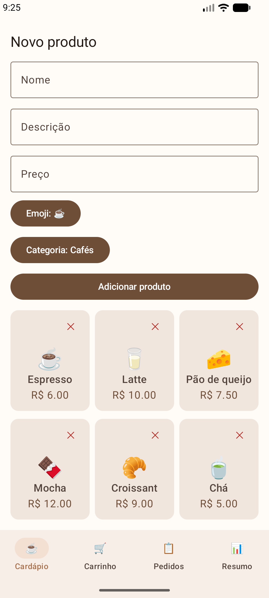
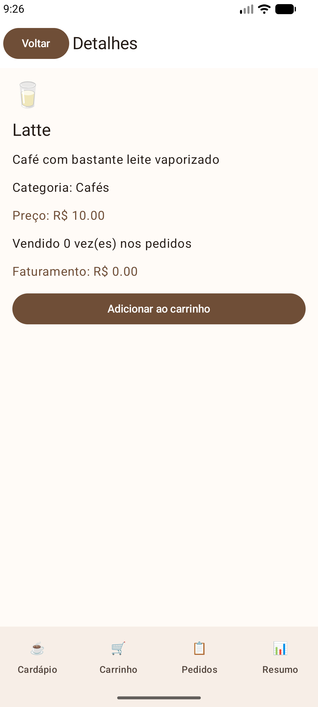
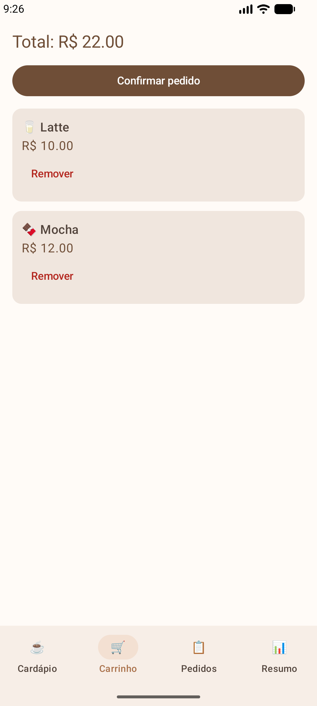
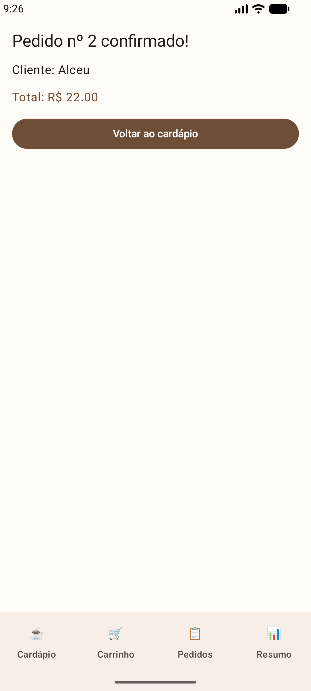
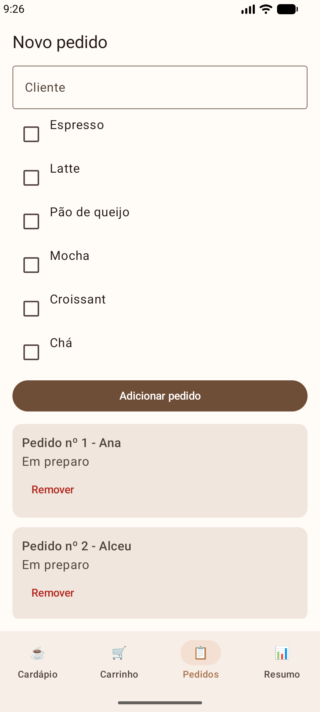
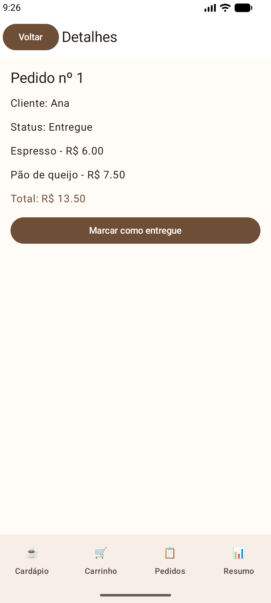
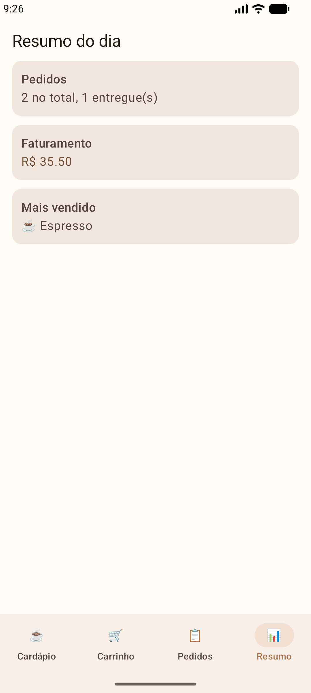

# CaféPositivo

App de pedidos de uma cafeteria, feito em Kotlin com Jetpack Compose, Material 3, Navigation
Compose e Room. Este é o **Trabalho 4 (Arquitetura MVVM)**: o mesmo app do Trabalho 3, com as
mesmas telas e as mesmas funções, reorganizado em camadas (Model — View — ViewModel).

> A documentação dos trabalhos anteriores (Trabalho 2 e Trabalho 3 — Room) está em
> [PROCESSO.md](PROCESSO.md).

## Como rodar

1. Abrir a pasta `MyApplication4` no Android Studio
2. Esperar o Gradle sincronizar
3. Rodar no emulador ou em um celular

O banco começa vazio: os produtos são cadastrados na própria tela de Cardápio.

## Telas (8)

| # | Tela | O que faz |
|---|---|---|
| 1 | Login | Campo de nome; o botão só libera com 3 letras ou mais |
| 2 | Cardápio | Formulário para adicionar produto, grade de produtos, remover pelo ✕, botão Sair |
| 3 | Detalhe do produto | Dados do produto, quantas vezes foi vendido e o faturamento, adicionar ao carrinho, editar produto |
| 4 | Carrinho | Itens escolhidos, remover item, total e confirmar pedido |
| 5 | Confirmação | Número do pedido, cliente e total |
| 6 | Pedidos | Lista de pedidos, abrir o detalhe, remover |
| 7 | Detalhe do pedido | Itens e total do pedido, botão "Marcar como entregue" |
| 8 | Resumo | Total de pedidos, entregues, faturamento e produto mais vendido |

A barra de baixo leva para Cardápio, Carrinho, Pedidos e Resumo.

---

# Trabalho 4 — Processo e decisões

> Rascunho para ser conferido e ajustado com as palavras do trio.
> Onde aparece **[PRINT AQUI]** / **[VÍDEO AQUI]**, colocar a imagem ou o vídeo (pasta `prints/`).

## 1. Como estava no Trabalho 3 e o que mudou

No Trabalho 3 o app já salvava tudo no Room, mas **cada tela fazia tudo sozinha**. Por exemplo, a
`TelaCardapio`:

- pegava o banco com `AppDatabase.getDatabase(context).produtoDao()`;
- guardava a lista e o formulário em 7 variáveis `remember` soltas;
- buscava os produtos num `LaunchedEffect(Unit)` com `CoroutineScope(Dispatchers.IO).launch`;
- depois de inserir ou remover, precisava chamar `buscarTodos()` de novo para a tela atualizar.

O carrinho e o nome do usuário eram **variáveis globais** no arquivo `Dados.kt`, que qualquer tela
podia alterar.

```kotlin
// Trabalho 3 — dentro do @Composable
CoroutineScope(Dispatchers.IO).launch {
    dao.inserir(novo)
    produtos = dao.buscarTodos()   // buscar de novo na mão
}
```

No Trabalho 4 a mesma ação ficou assim:

```kotlin
// Tela: só avisa o ViewModel
Button(onClick = { viewModel.adicionarProduto() }) { Text("Adicionar produto") }

// ViewModel: chama o Repository; a lista nova chega sozinha pelo Flow
fun adicionarProduto() {
    ...
    viewModelScope.launch { produtoRepository.inserir(novo) }
}
```

Resumo do que mudou:

| Antes (Trabalho 3) | Agora (Trabalho 4) |
|---|---|
| Tudo no pacote raiz | 4 pacotes: `ui`, `data`, `data.repository`, `viewmodel` |
| Tela chamava o DAO | Tela → ViewModel → Repository → DAO |
| `suspend fun buscarTodos(): List<...>` | `fun buscarTodos(): Flow<List<...>>` |
| Buscar a lista de novo depois de cada mudança | O Room avisa sozinho pelo Flow |
| Vários `remember` por tela | Um `UiState` por tela, dentro do ViewModel |
| `CoroutineScope(Dispatchers.IO)` na tela | `viewModelScope.launch` no ViewModel |
| `withContext(Dispatchers.Main)` para navegar | Não precisa: `viewModelScope` já roda na thread principal |
| `Dados.kt` com variáveis globais | `SessaoViewModel` com `SessaoUiState` |

Nenhuma tela, campo ou função nova foi criada.

**[PRINT AQUI: estrutura de pacotes no Android Studio]**

## 2. Como dividimos os pacotes

- **`data`** — o que já existia do Room, sem mudar a lógica: `Produto`, `Pedido`, `ProdutoDao`,
  `PedidoDao` e `AppDatabase`. A única mudança foi o `buscarTodos()` virar `Flow`.
- **`data.repository`** — fica dentro de `data` porque também é camada de dados: é quem decide de
  onde os dados vêm.
- **`viewmodel`** — os ViewModels, cada um com seu `UiState` no mesmo arquivo (fica mais fácil
  ler os dois juntos), e a `CafeViewModelFactory`.
- **`ui`** — as 8 telas e o `AppNavigation`. O pacote `ui.theme` já existia e continuou igual.
- **`MainActivity`** ficou no pacote raiz: é o ponto de partida do app e é nela que as camadas são
  ligadas (cria o banco, os Repositories e a Factory e passa a Factory para o `AppNavigation`).
  Assim nenhuma tela precisa saber que o banco existe.

Para mover os arquivos usamos **Refactor → Move** do Android Studio, que já corrige os `package`
e os `import`.

## 3. Por que o Repository existe

Antes, a tela sabia que os dados vinham do Room — ela chamava o DAO direto. Se um dia os produtos
viessem de uma API, teríamos que mexer em todas as telas.

Com o Repository, **só ele conhece o DAO**. O ViewModel pede `produtoRepository.buscarTodos()` e não
sabe (nem precisa saber) se aquilo veio do banco, da internet ou de uma lista em memória. Se a origem
mudar, só o Repository muda.

Hoje ele só repassa as chamadas:

```kotlin
class ProdutoRepository(private val produtoDao: ProdutoDao) {
    fun buscarTodos(): Flow<List<Produto>> = produtoDao.buscarTodos()
    suspend fun inserir(produto: Produto) = produtoDao.inserir(produto)
    ...
}
```

Ele é a **única fonte de verdade**: todo dado de produto passa por ele.

## 4. O que tem em cada UiState e por quê

A regra que usamos: **tudo que a tela precisa para se desenhar** vai no UiState. A única exceção são
os menus de emoji/categoria abertos ou fechados no Cardápio, que são só detalhe visual e ficaram no
`remember` da tela.

| ViewModel | UiState | Campos | Por quê |
|---|---|---|---|
| `CardapioViewModel` | `CardapioUiState` | `produtos`, `nome`, `descricao`, `preco`, `emoji`, `categoria` | A grade de produtos + o formulário "Novo produto" (eram 7 `remember` soltos) |
| `DetalheProdutoViewModel` | `DetalheProdutoUiState` | `produto`, `vezesVendido`, `faturamento`, `nome`, `descricao`, `preco` | O produto (null = "Carregando..."), a complexidade extra já calculada e o formulário de edição |
| `PedidosViewModel` | `PedidosUiState` | `pedidos` | A aba Pedidos só lista e remove |
| `DetalhePedidoViewModel` | `DetalhePedidoUiState` | `pedido`, `itens` | `itens` já vem pronto: um produto por id do pedido, ou `null` se o produto foi apagado ("Produto removido"). Usado também pela Confirmação, que mostra o mesmo pedido |
| `ResumoViewModel` | `ResumoUiState` | `totalPedidos`, `entregues`, `faturamento`, `maisVendido` | A tela só mostra números; a conta saiu da tela e foi para o ViewModel |
| `SessaoViewModel` | `SessaoUiState` | `nomeUsuario`, `carrinho` (+ `total`, `podeEntrar`, `podeConfirmar` calculados) | Substitui o `Dados.kt`. É o estado que várias telas compartilham |

Todos seguem o mesmo padrão:

```kotlin
private val _uiState = MutableStateFlow(CardapioUiState())         // só o ViewModel altera
val uiState: StateFlow<CardapioUiState> = _uiState.asStateFlow()   // a tela só lê
```

E na tela:

```kotlin
val viewModel: CardapioViewModel = viewModel(factory = factory)
val uiState by viewModel.uiState.collectAsStateWithLifecycle()
```

**Por que o `SessaoViewModel` é criado no `AppNavigation`?** O carrinho precisa ser o mesmo no
Detalhe do produto (onde o item entra), no Carrinho e no Cardápio (botão Sair). Se cada tela pedisse
o seu `viewModel()` dentro do `NavHost`, cada uma teria um carrinho diferente. Criando uma vez fora do
`NavHost`, ele vive enquanto a Activity existir e é passado para as telas que precisam.

**Por que uma Factory só?** O enunciado permite "uma só reaproveitada, se fizer sentido". Todos os
ViewModels precisam de um ou dos dois Repositories, então a `CafeViewModelFactory` recebe os dois e,
pelo tipo pedido, cria o ViewModel certo.

**[PRINT AQUI: um ViewModel e seu UiState no Android Studio]**

## 5. Alguma funcionalidade quebrou? Como encontramos e corrigimos

> Conferir com o que aconteceu de verdade com o trio e ajustar.

- **Erros de compilação depois de mover os arquivos.** Ao mover para os pacotes, apareceram erros de
  `import`. Resolvemos usando o Refactor → Move do Android Studio e corrigindo os que sobraram.
- **`buscarTodos()` virou Flow e as telas pararam de compilar.** O código antigo fazia
  `produtos = dao.buscarTodos()`. Com Flow isso não funciona mais: o ViewModel passou a "ouvir" o Flow
  com `collect` no `init`, e a lista chega sozinha a cada mudança.
- **Carrinho vazio.** Se o `SessaoViewModel` for criado em cada tela, o produto adicionado no
  Detalhe não aparece no Carrinho. Corrigido criando ele uma vez no `AppNavigation` (ver seção 4).
- **Formulário de edição sendo apagado.** No Detalhe do produto, o formulário é preenchido uma vez
  com os dados do banco; se preenchesse de novo a cada emissão do Flow, apagaria o que o usuário
  estava digitando. Por isso o produto é buscado com `buscarPorId` (uma vez) e só a contagem de
  vendas usa Flow.
- **Navegar depois de salvar.** No Trabalho 3 precisávamos de `withContext(Dispatchers.Main)` para
  navegar depois de inserir. Agora o ViewModel recebe uma função (`aoSalvar`, `aoConfirmar`) e a chama
  quando termina; como o `viewModelScope` roda na thread principal, a tela navega direto.

**[VÍDEO AQUI: app funcionando — adicionar, listar, atualizar, remover e persistir]**

## 6. Dificuldades do trio

**[PREENCHER: o que cada integrante achou difícil e como resolveram]**

---

## Imagens

<table>
  <tr>
    <td align="center" width="33%">
      <b>1. Login</b><br>
      <br>
      <sub>Botão só libera com 3 letras ou mais</sub>
    </td>
    <td align="center" width="33%">
      <b>2a. Cardápio — Formulário</b><br>
      <br>
      <sub>Adicionar produto pelo formulário</sub>
    </td>
    <td align="center" width="33%">
      <b>2b. Cardápio — Grade</b><br>
      <br>
      <sub>Lista de produtos com remoção pelo ✕</sub>
    </td>
  </tr>
  <tr>
    <td align="center">
      <b>3. Detalhe do produto</b><br>
      <br>
      <sub>Vendas, faturamento e edição</sub>
    </td>
    <td align="center">
      <b>4. Carrinho</b><br>
      <br>
      <sub>Itens escolhidos, total e confirmar pedido</sub>
    </td>
    <td align="center">
      <b>5. Confirmação</b><br>
      <br>
      <sub>Número do pedido, cliente e total</sub>
    </td>
  </tr>
  <tr>
    <td align="center">
      <b>6. Pedidos</b><br>
      <br>
      <sub>Pedidos já realizados</sub>
    </td>
    <td align="center">
      <b>7. Detalhe do pedido</b><br>
      <br>
      <sub>Itens e valores de um pedido</sub>
    </td>
    <td align="center">
      <b>8. Resumo</b><br>
      <br>
      <sub>Pedidos, faturamento e mais vendido</sub>
    </td>
  </tr>
</table>

## Tecnologias

Kotlin, Jetpack Compose, Material 3, Navigation Compose, Room, ViewModel, StateFlow e Kotlin Flow.
